# WhatsApp Messaging Interface

<cite>
**Referenced Files in This Document**   
- [server.js](file://backend/server.js)
- [whatsapp.js](file://backend/routes/whatsapp.js)
- [whatsappService.js](file://backend/utils/whatsappService.js)
- [template.js](file://backend/routes/template.js)
- [metaTemplateService.js](file://backend/utils/metaTemplateService.js)
- [conversationFlow.js](file://backend/utils/conversationFlow.js)
- [MessageLog.js](file://backend/models/MessageLog.js)
- [Template.js](file://backend/models/Template.js)
- [metaConfigHelper.js](file://backend/utils/metaConfigHelper.js)
- [Whatsapp_Message.jsx](file://frontend/src/Dashboard/Whatsapp_Message.jsx)
- [WhatsappBlast.jsx](file://frontend/src/Dashboard/WhatsappBlast.jsx)
</cite>

## Update Summary
**Changes Made**   
- Added comprehensive OTP (One-Time Password) input component with real-time validation
- Implemented user guidance for authentication templates with visual indicators
- Added disabled send button states when OTP is required but missing
- Enhanced template selection logic to detect authentication templates automatically
- Integrated client-side and server-side OTP validation with consistent error handling

## Table of Contents
1. [Introduction](#introduction)
2. [Project Structure](#project-structure)
3. [Core Components](#core-components)
4. [Architecture Overview](#architecture-overview)
5. [Detailed Component Analysis](#detailed-component-analysis)
6. [OTP Input System](#otp-input-system)
7. [Dependency Analysis](#dependency-analysis)
8. [Performance Considerations](#performance-considerations)
9. [Troubleshooting Guide](#troubleshooting-guide)
10. [Conclusion](#conclusion)

## Introduction
This document explains the WhatsApp messaging interface implementation, covering:
- Real-time chat UI and WebSocket-based notifications
- Message composition tools and template studio
- **Enhanced OTP input system with validation and user guidance**
- Meta Business API integration for templates, media, and message sending
- Webhook processing for incoming messages and delivery/read statuses
- Conversation threading via message logs and contact context
- Bulk messaging capabilities through a blast workflow

The system uses Express for REST APIs, Socket.io for real-time events, MongoDB for persistence, and the Meta Cloud API for WhatsApp messaging. The frontend provides a live chat view, template management, bulk broadcast features, and enhanced OTP handling for authentication templates.

## Project Structure
The project is split into backend and frontend layers:
- Backend: Express routes, utility services, models, and WebSocket server setup
- Frontend: React dashboard with live chat, template studio, blast composer, and OTP input components

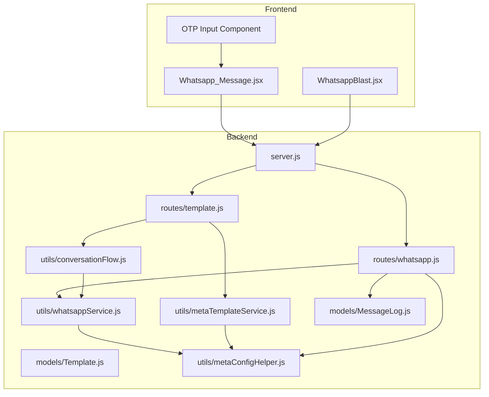

**Diagram sources**
- [server.js:11-56](file://backend/server.js#L11-L56)
- [whatsapp.js:1-10](file://backend/routes/whatsapp.js#L1-L10)
- [template.js:1-30](file://backend/routes/template.js#L1-L30)
- [whatsappService.js:1-5](file://backend/utils/whatsappService.js#L1-L5)
- [metaTemplateService.js:1-5](file://backend/utils/metaTemplateService.js#L1-L5)
- [conversationFlow.js:1-7](file://backend/utils/conversationFlow.js#L1-L7)
- [MessageLog.js:1-22](file://backend/models/MessageLog.js#L1-L22)
- [Template.js:1-20](file://backend/models/Template.js#L1-L20)
- [metaConfigHelper.js:1-5](file://backend/utils/metaConfigHelper.js#L1-L5)

**Section sources**
- [server.js:11-56](file://backend/server.js#L11-L56)
- [whatsapp.js:1-10](file://backend/routes/whatsapp.js#L1-L10)
- [template.js:1-30](file://backend/routes/template.js#L1-L30)

## Core Components
- Real-time chat UI: Live chat list, message rendering, unread badges, and WebSocket event handling
- Template Studio: Create/edit templates, preview variables, upload header media, submit to Meta
- **Enhanced OTP Input System: One-time code entry with validation, user guidance, and conditional send button states**
- Meta Integration: Credentials management, template CRUD, media upload, message sending
- Webhooks: Incoming message ingestion, status updates, auto-reply automation
- Broadcast Engine: Bulk send approved templates to contacts or leads

Key responsibilities:
- `server.js`: HTTP + WebSocket server, route mounting, cron scheduler
- `routes/whatsapp.js`: Status, config, webhooks, message retrieval
- `utils/whatsappService.js`: Meta Cloud API client for text, media, buttons, lists, polls, templates
- `routes/template.js`: Template lifecycle, validation, media resolution, Meta submission, broadcasts
- `utils/metaTemplateService.js`: Meta Graph API calls for templates and media
- `utils/conversationFlow.js`: Template personalization and sending pipeline with OTP support
- `models/MessageLog.js`, `models/Template.js`: Persistence schemas
- `utils/metaConfigHelper.js`: Credential caching and verification
- `frontend/src/Dashboard/Whatsapp_Message.jsx`: Live chat, template studio, WebSocket listeners, OTP input handling
- `frontend/src/Dashboard/WhatsappBlast.jsx`: Bulk sender UI and dispatch flow

**Section sources**
- [server.js:11-80](file://backend/server.js#L11-L80)
- [whatsapp.js:8-109](file://backend/routes/whatsapp.js#L8-L109)
- [whatsappService.js:45-215](file://backend/utils/whatsappService.js#L45-L215)
- [template.js:146-199](file://backend/routes/template.js#L146-L199)
- [metaTemplateService.js:114-179](file://backend/utils/metaTemplateService.js#L114-L179)
- [conversationFlow.js:21-118](file://backend/utils/conversationFlow.js#L21-L118)
- [MessageLog.js:3-19](file://backend/models/MessageLog.js#L3-L19)
- [Template.js:3-68](file://backend/models/Template.js#L3-L68)
- [metaConfigHelper.js:6-35](file://backend/utils/metaConfigHelper.js#L6-L35)
- [Whatsapp_Message.jsx:212-537](file://frontend/src/Dashboard/Whatsapp_Message.jsx#L212-L537)
- [WhatsappBlast.jsx:18-151](file://frontend/src/Dashboard/WhatsappBlast.jsx#L18-L151)

## Architecture Overview
The system integrates three main flows:
- Outbound messaging: UI triggers -> backend sends via Meta Cloud API -> status webhook updates DB -> WebSocket notifies UI
- Inbound messaging: Meta webhook -> backend persists and emits WebSocket events -> optional automation replies
- Template lifecycle: UI creates/edits -> backend validates and submits to Meta -> syncs status and stores components
- **OTP Processing**: Authentication templates require one-time codes with validation before sending

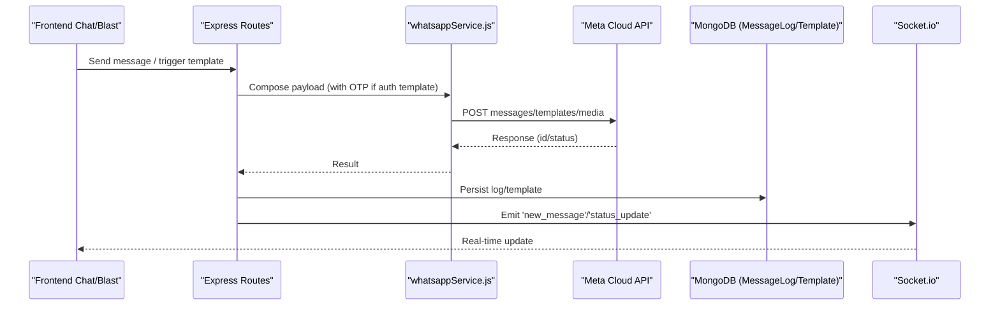

**Diagram sources**
- [whatsapp.js:135-311](file://backend/routes/whatsapp.js#L135-L311)
- [whatsappService.js:45-215](file://backend/utils/whatsappService.js#L45-L215)
- [template.js:318-391](file://backend/routes/template.js#L318-L391)
- [server.js:14-35](file://backend/server.js#L14-L35)

## Detailed Component Analysis

### Real-Time Chat Interface
The live chat component manages:
- Contact selection and chat history loading
- WebSocket connection for real-time inbound messages, auto-replies, and status updates
- Unread badge computation based on last read timestamps stored locally
- Polling fallback for chat logs and unread counts

Key behaviors:
- Connects to Socket.io and listens to `new_message`, `auto_reply`, and `status_update`
- Updates local chat log map keyed by normalized phone number
- Marks messages as incoming/outgoing and renders template metadata when present
- Polls every 3 seconds for new logs and unread counts when in live chat mode

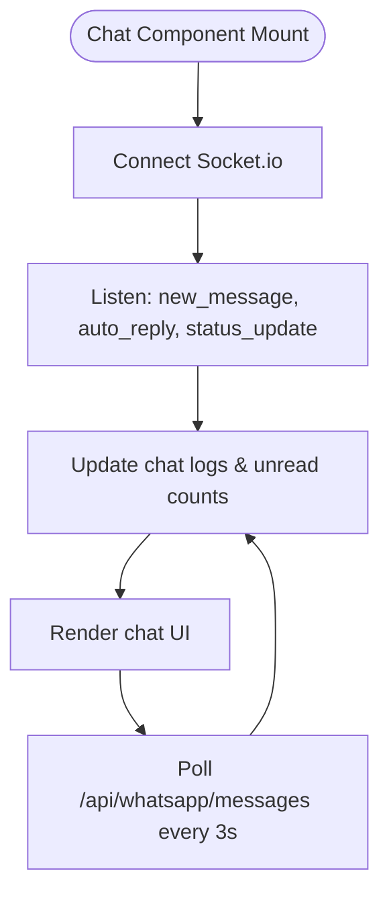

**Diagram sources**
- [Whatsapp_Message.jsx:470-537](file://frontend/src/Dashboard/Whatsapp_Message.jsx#L470-L537)
- [Whatsapp_Message.jsx:754-772](file://frontend/src/Dashboard/Whatsapp_Message.jsx#L754-L772)

**Section sources**
- [Whatsapp_Message.jsx:212-537](file://frontend/src/Dashboard/Whatsapp_Message.jsx#L212-L537)
- [Whatsapp_Message.jsx:659-772](file://frontend/src/Dashboard/Whatsapp_Message.jsx#L659-L772)

### Message Composition Tools and Template Studio
The template studio supports:
- Category presets (Marketing, Utility, Authentication)
- Header types (None, Text, Image)
- Body text with variable placeholders (`{{1}}`, named variables)
- Buttons (Quick Reply, URL, Phone Number, OTP)
- Sample values for preview
- Local draft editing vs. recreate-on-Meta for immutable templates

Processing highlights:
- Extracts body variables and aligns sample values automatically
- Validates against backend rules and limits
- Resolves header media via resumable upload handles for Meta
- Submits to Meta and maps response to local template fields

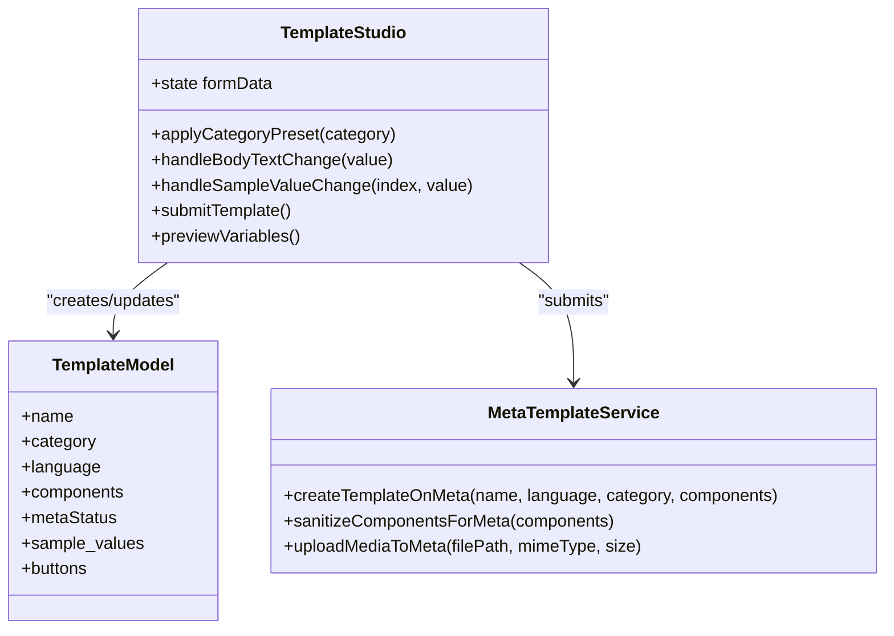

**Diagram sources**
- [Whatsapp_Message.jsx:93-210](file://frontend/src/Dashboard/Whatsapp_Message.jsx#L93-L210)
- [Template.js:3-68](file://backend/models/Template.js#L3-L68)
- [metaTemplateService.js:23-112](file://backend/utils/metaTemplateService.js#L23-L112)

**Section sources**
- [Whatsapp_Message.jsx:93-210](file://frontend/src/Dashboard/Whatsapp_Message.jsx#L93-L210)
- [template.js:146-199](file://backend/routes/template.js#L146-L199)
- [metaTemplateService.js:114-179](file://backend/utils/metaTemplateService.js#L114-L179)

### Media Handling
Media handling covers two paths:
- Sending media with outbound messages: Upload to `/phoneId/media` and reference by ID or link
- Template header media: Use resumable upload handle for template creation; also generate media ID for sending later

Implementation details:
- For images sent directly, if a URL is provided it is used; otherwise, local files are uploaded to Meta to obtain a media ID
- For templates, header media must be uploaded via resumable upload to get a handle; the service also uploads a media ID for sending and a public URL for dashboard previews

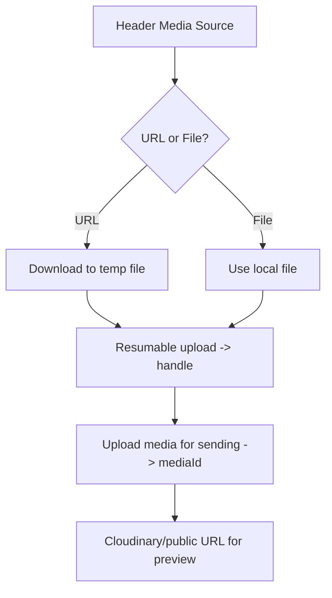

**Diagram sources**
- [template.js:55-140](file://backend/routes/template.js#L55-L140)
- [metaTemplateService.js:192-245](file://backend/utils/metaTemplateService.js#L192-L245)
- [whatsappService.js:80-123](file://backend/utils/whatsappService.js#L80-L123)

**Section sources**
- [template.js:55-140](file://backend/routes/template.js#L55-L140)
- [metaTemplateService.js:192-245](file://backend/utils/metaTemplateService.js#L192-L245)
- [whatsappService.js:80-123](file://backend/utils/whatsappService.js#L80-L123)

### WebSocket Connection Management and Real-Time Notifications
WebSocket server setup:
- Initializes Socket.io with CORS enabled
- Stores `io` instance in Express app for route handlers to emit events
- Supports room joining (not actively used by current routes but available)

Real-time events emitted:
- `new_message`: When an inbound customer message is received
- `auto_reply`: When automation bot replies
- `status_update`: When delivery/read statuses arrive from Meta

Frontend behavior:
- Connects to Socket.io and listens for these events
- Updates chat logs and unread counts accordingly
- Handles reconnection and disconnect states

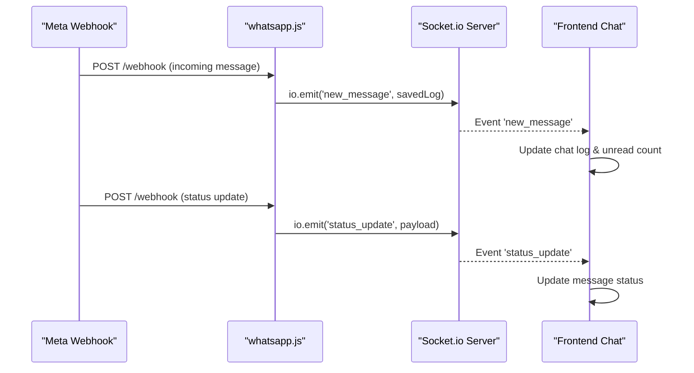

**Diagram sources**
- [server.js:14-35](file://backend/server.js#L14-L35)
- [whatsapp.js:206-211](file://backend/routes/whatsapp.js#L206-L211)
- [whatsapp.js:293-297](file://backend/routes/whatsapp.js#L293-L297)
- [Whatsapp_Message.jsx:470-537](file://frontend/src/Dashboard/Whatsapp_Message.jsx#L470-L537)

**Section sources**
- [server.js:14-35](file://backend/server.js#L14-L35)
- [whatsapp.js:206-211](file://backend/routes/whatsapp.js#L206-L211)
- [whatsapp.js:293-297](file://backend/routes/whatsapp.js#L293-L297)
- [Whatsapp_Message.jsx:470-537](file://frontend/src/Dashboard/Whatsapp_Message.jsx#L470-L537)

### Message Sending/Receiving Protocols
Outbound protocols:
- Text messages: Simple payload with recipient and body
- Interactive messages: Buttons and list menus
- Templates: Name, language, and optional components for headers/body/buttons
- **Authentication templates: Include one-time code validation and OTP button parameters**
- Media: Either direct link or uploaded media ID

Inbound protocol:
- Webhook payloads include entry changes with messages and statuses
- Messages parsed into text or interactive/button payloads
- Contacts upserted automatically for inbound senders

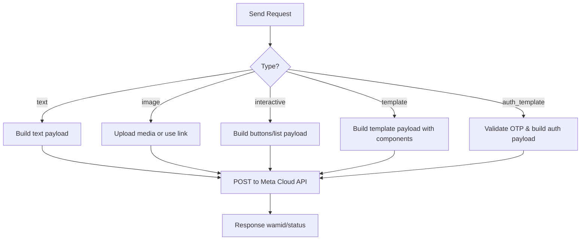

**Diagram sources**
- [whatsappService.js:61-78](file://backend/utils/whatsappService.js#L61-L78)
- [whatsappService.js:80-123](file://backend/utils/whatsappService.js#L80-L123)
- [whatsappService.js:125-192](file://backend/utils/whatsappService.js#L125-L192)
- [whatsappService.js:194-215](file://backend/utils/whatsappService.js#L194-L215)

**Section sources**
- [whatsappService.js:61-215](file://backend/utils/whatsappService.js#L61-L215)
- [whatsapp.js:135-311](file://backend/routes/whatsapp.js#L135-L311)

### Conversation Threading and Context Management
Threading model:
- Messages are persisted per WAMID with direction, status, and timestamp
- Contacts are upserted on inbound messages to maintain conversation context
- Chat logs are fetched per phone with normalization across multiple formats
- Unread counts computed using last read timestamps stored in localStorage

Context management:
- Normalized phone keys (last 10 digits) used for mapping chat logs and unread counts
- Last seen timestamps updated when selecting a contact to clear unread badges
- Latest activity timestamps used for sorting contacts by recent engagement

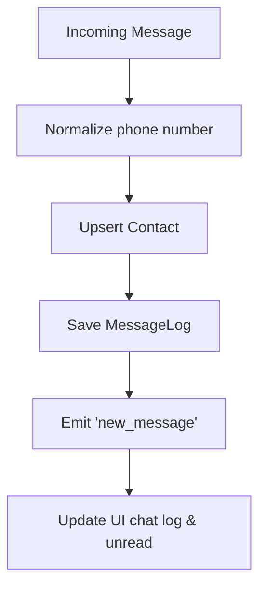

**Diagram sources**
- [whatsapp.js:167-211](file://backend/routes/whatsapp.js#L167-L211)
- [Whatsapp_Message.jsx:659-772](file://frontend/src/Dashboard/Whatsapp_Message.jsx#L659-L772)

**Section sources**
- [whatsapp.js:167-211](file://backend/routes/whatsapp.js#L167-L211)
- [Whatsapp_Message.jsx:659-772](file://frontend/src/Dashboard/Whatsapp_Message.jsx#L659-L772)

### Template Selection, Personalization Variables, and Bulk Messaging
Template selection:
- Frontend fetches templates from multiple endpoints and maps them to a unified structure
- Presets provide starter content per category including authentication templates
- Preview shows header, body, footer, and buttons with variable substitution

Personalization variables:
- Body variables extracted and aligned with sample values
- Automation flow injects contact name into template body when needed
- **Authentication templates use OTP codes instead of standard variables**

Bulk messaging:
- Blast UI selects recipients (contacts or leads), chooses an approved template, and dispatches
- Backend verifies template approval before sending and runs broadcast loop with delays
- Each send persists a MessageLog and increments contact stats
- **Authentication templates restricted to single recipient with OTP validation**

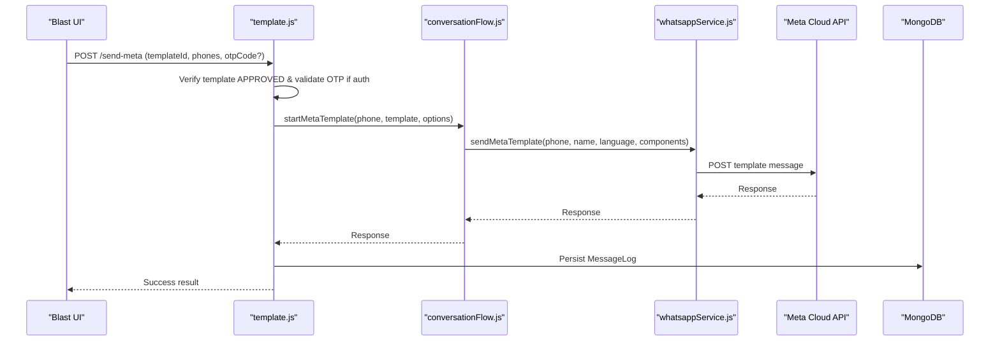

**Diagram sources**
- [template.js:318-391](file://backend/routes/template.js#L318-L391)
- [conversationFlow.js:21-118](file://backend/utils/conversationFlow.js#L21-L118)
- [whatsappService.js:194-215](file://backend/utils/whatsappService.js#L194-L215)
- [WhatsappBlast.jsx:298-327](file://frontend/src/Dashboard/WhatsappBlast.jsx#L298-L327)

**Section sources**
- [Whatsapp_Message.jsx:544-617](file://frontend/src/Dashboard/Whatsapp_Message.jsx#L544-L617)
- [WhatsappBlast.jsx:67-151](file://frontend/src/Dashboard/WhatsappBlast.jsx#L67-L151)
- [template.js:318-391](file://backend/routes/template.js#L318-L391)
- [conversationFlow.js:21-118](file://backend/utils/conversationFlow.js#L21-L118)

### Integration with Meta Business API, Webhook Processing, and Message Status Tracking
Integration points:
- Credentials managed via `metaConfigHelper.js`, cached and verified against Meta Graph API
- Templates created/updated/deleted via `metaTemplateService.js`
- Messages sent via `whatsappService.js`
- Webhooks processed in `routes/whatsapp.js` for incoming messages and status updates

Webhook processing:
- Verification endpoint validates hub.verify_token
- Incoming messages parsed and persisted; contacts upserted; WebSocket event emitted
- Status updates parsed and persisted; WebSocket event emitted

Status tracking:
- MessageLog stores direction, status, error codes, pricing, and identifiers
- Frontend displays status indicators and error messages

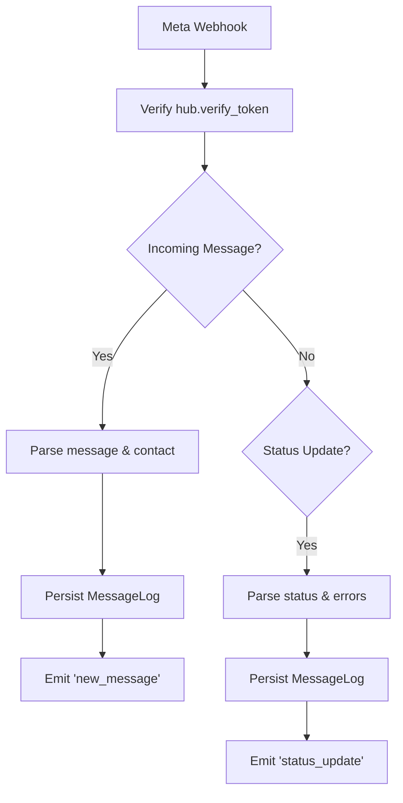

**Diagram sources**
- [whatsapp.js:114-132](file://backend/routes/whatsapp.js#L114-L132)
- [whatsapp.js:135-311](file://backend/routes/whatsapp.js#L135-L311)
- [MessageLog.js:3-19](file://backend/models/MessageLog.js#L3-L19)

**Section sources**
- [metaConfigHelper.js:6-35](file://backend/utils/metaConfigHelper.js#L6-L35)
- [metaTemplateService.js:114-179](file://backend/utils/metaTemplateService.js#L114-L179)
- [whatsapp.js:114-311](file://backend/routes/whatsapp.js#L114-L311)
- [MessageLog.js:3-19](file://backend/models/MessageLog.js#L3-L19)

### Real-Time Notifications, Offline Message Queuing, and Conversation Context Management
Real-time notifications:
- WebSocket events push inbound messages, auto-replies, and status updates to the UI
- UI updates state immediately without polling when connected

Offline message queuing:
- No explicit queue implementation found; messages are persisted to MongoDB and polled by the UI
- Polling interval ensures eventual consistency even if WebSocket is unavailable

Conversation context management:
- Contacts are maintained and updated on inbound messages
- Chat logs are grouped by normalized phone numbers
- Unread counts and latest activity timestamps drive UI sorting and badges

**Section sources**
- [server.js:14-35](file://backend/server.js#L14-L35)
- [whatsapp.js:167-211](file://backend/routes/whatsapp.js#L167-L211)
- [Whatsapp_Message.jsx:754-772](file://frontend/src/Dashboard/Whatsapp_Message.jsx#L754-L772)

## OTP Input System

### Enhanced OTP Input Component
The OTP input system provides a secure and user-friendly way to handle authentication templates:

**Key Features:**
- **Visual Indicators**: Amber-themed input field with clear labeling and guidance text
- **Real-time Validation**: Client-side validation ensuring 4-10 character codes without spaces
- **Conditional Send Button**: Automatically disabled when OTP is required but missing
- **Auto-completion Support**: Browser autofill integration for OTP codes
- **User Guidance**: Clear instructions explaining OTP requirements and security

**Implementation Details:**
- State management with `chatOtpCode` useState hook
- Automatic detection of authentication templates based on category
- Visual feedback with amber border and background highlighting
- Placeholder text "123456" with monospace font for better readability
- Maximum length constraint of 10 characters enforced at input level

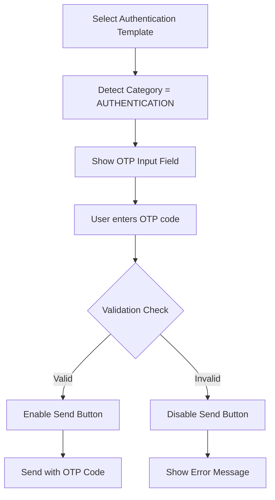

**Diagram sources**
- [Whatsapp_Message.jsx:1041-1051](file://frontend/src/Dashboard/Whatsapp_Message.jsx#L1041-L1051)
- [Whatsapp_Message.jsx:2120-2141](file://frontend/src/Dashboard/Whatsapp_Message.jsx#L2120-L2141)
- [Whatsapp_Message.jsx:2150](file://frontend/src/Dashboard/Whatsapp_Message.jsx#L2150)

### OTP Validation and Security
The system implements comprehensive validation at both client and server levels:

**Client-side Validation:**
- Format validation: `/^\S{4,10}$/` ensures 4-10 non-space characters
- Empty check prevents sending without OTP for authentication templates
- Immediate user feedback via toast notifications

**Server-side Validation:**
- Duplicate validation ensures data integrity
- Authentication template restriction to single recipient only
- Secure OTP transmission without storage in database

**Security Measures:**
- OTP codes are never stored in the database
- Codes are transmitted securely via API requests
- Validation occurs before any message processing
- Error messages don't reveal sensitive information

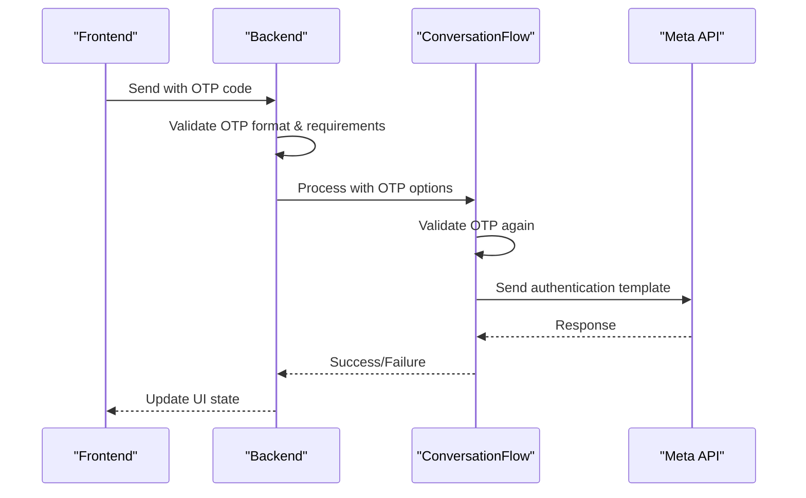

**Diagram sources**
- [Whatsapp_Message.jsx:1041-1051](file://frontend/src/Dashboard/Whatsapp_Message.jsx#L1041-L1051)
- [template.js:443-465](file://backend/routes/template.js#L443-L465)
- [conversationFlow.js:32-47](file://backend/utils/conversationFlow.js#L32-L47)

**Section sources**
- [Whatsapp_Message.jsx:245](file://frontend/src/Dashboard/Whatsapp_Message.jsx#L245)
- [Whatsapp_Message.jsx:1041-1051](file://frontend/src/Dashboard/Whatsapp_Message.jsx#L1041-L1051)
- [Whatsapp_Message.jsx:2120-2141](file://frontend/src/Dashboard/Whatsapp_Message.jsx#L2120-L2141)
- [Whatsapp_Message.jsx:2150](file://frontend/src/Dashboard/Whatsapp_Message.jsx#L2150)
- [template.js:443-465](file://backend/routes/template.js#L443-L465)
- [conversationFlow.js:32-47](file://backend/utils/conversationFlow.js#L32-L47)

### User Experience Enhancements
The OTP system provides excellent user experience through:

**Visual Design:**
- Amber color scheme for authentication-related elements
- Clear typography with uppercase labels and tracking
- Responsive layout that adapts to different screen sizes
- Smooth transitions and hover states

**Accessibility:**
- Proper ARIA labels and semantic HTML structure
- Keyboard navigation support
- Screen reader compatibility
- High contrast ratios for readability

**Error Handling:**
- Descriptive error messages guiding users to correct issues
- Visual feedback for invalid inputs
- Graceful degradation when OTP is not provided
- Consistent error presentation across the application

**Section sources**
- [Whatsapp_Message.jsx:2120-2141](file://frontend/src/Dashboard/Whatsapp_Message.jsx#L2120-L2141)
- [Whatsapp_Message.jsx:2150](file://frontend/src/Dashboard/Whatsapp_Message.jsx#L2150)

## Dependency Analysis
Component relationships:
- `server.js` mounts routes and exposes Socket.io instance
- `routes/whatsapp.js` depends on `whatsappService.js`, `metaConfigHelper.js`, and `MessageLog`
- `routes/template.js` depends on `metaTemplateService.js`, `conversationFlow.js`, and `Template`
- `conversationFlow.js` depends on `whatsappService.js` and `metaTemplateService.js`
- Frontend components depend on backend REST endpoints and WebSocket events
- **OTP system integrates with template selection, validation, and sending workflows**

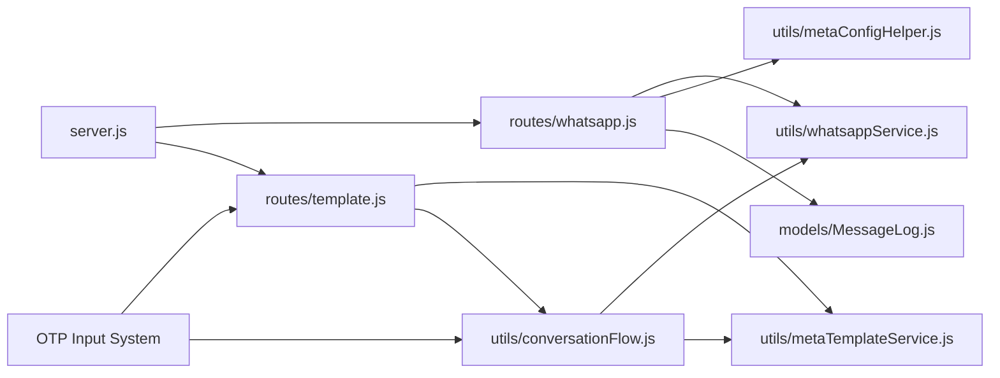

**Diagram sources**
- [server.js:43-56](file://backend/server.js#L43-L56)
- [whatsapp.js:1-10](file://backend/routes/whatsapp.js#L1-L10)
- [template.js:1-30](file://backend/routes/template.js#L1-L30)
- [conversationFlow.js:1-7](file://backend/utils/conversationFlow.js#L1-L7)

**Section sources**
- [server.js:43-56](file://backend/server.js#L43-L56)
- [whatsapp.js:1-10](file://backend/routes/whatsapp.js#L1-L10)
- [template.js:1-30](file://backend/routes/template.js#L1-L30)
- [conversationFlow.js:1-7](file://backend/utils/conversationFlow.js#L1-L7)

## Performance Considerations
- Webhook processing performs database writes and WebSocket emissions synchronously; consider background jobs for high throughput
- Broadcast loops include small delays to respect Meta rate limits; tune delay and concurrency based on account limits
- Template media uploads involve multiple network calls; cache media IDs where possible
- Frontend polling interval (3 seconds) balances freshness and load; adjust based on expected message volume
- WebSocket reconnection handled by socket.io-client; ensure proper cleanup on component unmount
- **OTP validation is performed client-side first to reduce unnecessary server requests**
- **Authentication template restrictions prevent bulk sending, reducing potential abuse**

[No sources needed since this section provides general guidance]

## Troubleshooting Guide
Common issues and resolutions:
- Missing Meta credentials: Ensure WABA ID, phone ID, and access token are configured; verify connection via status endpoint
- Template not approved: Backend checks template status before sending; resubmit or wait for approval
- Webhook verification failures: Confirm hub.verify_token matches configured value
- Media upload errors: Check file size, MIME type, and resumable upload handle usage for templates
- WebSocket disconnected: UI shows connection state; check CORS settings and server availability
- **OTP validation errors**: Ensure code is 4-10 characters without spaces; authentication templates require single recipient
- **Disabled send button**: Verify OTP is entered for authentication templates; check template category selection

Operational tips:
- Use `/api/whatsapp/status` to check connectivity
- Use `/api/whatsapp/config` to inspect masked credentials and version
- Monitor MessageLog for error codes and messages
- Clear Meta config cache after environment changes
- **Test OTP functionality with sample codes like "123456" during development**

**Section sources**
- [whatsapp.js:8-36](file://backend/routes/whatsapp.js#L8-L36)
- [metaConfigHelper.js:73-99](file://backend/utils/metaConfigHelper.js#L73-L99)
- [template.js:397-441](file://backend/routes/template.js#L397-L441)

## Conclusion
The WhatsApp messaging interface provides a comprehensive solution for real-time chat, template-driven messaging, and bulk broadcasts integrated with Meta Business API. It leverages WebSockets for live updates, robust webhook processing for inbound and status events, and a structured template lifecycle with media handling. 

**The enhanced OTP input system adds enterprise-grade security for authentication workflows, providing secure one-time code handling with comprehensive validation, user guidance, and intuitive interface design.** The architecture balances immediate feedback with reliable persistence, enabling scalable operations for conversational workflows while maintaining security best practices for sensitive authentication scenarios.

[No sources needed since this section summarizes without analyzing specific files]