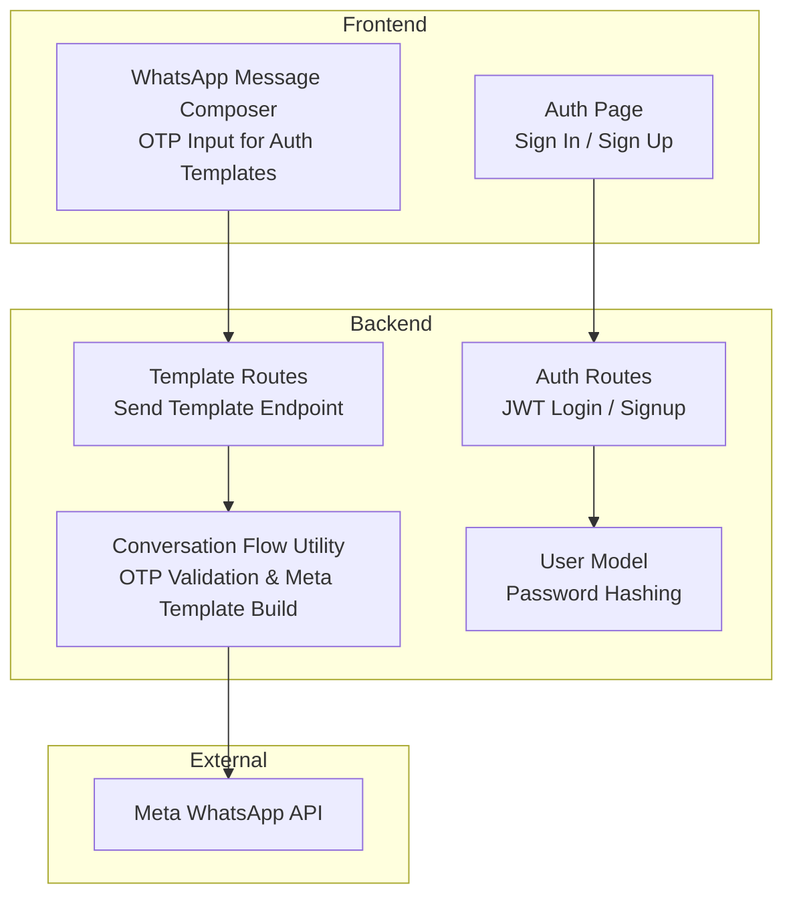
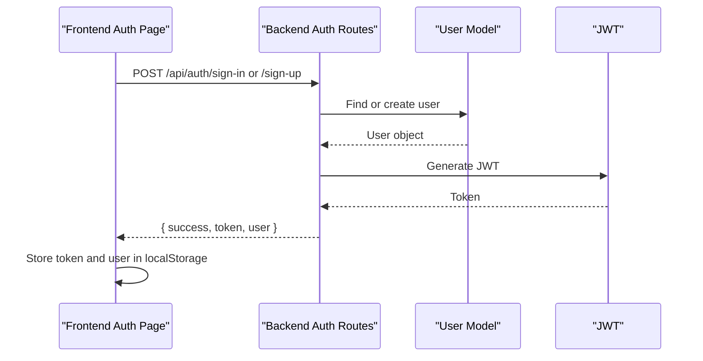
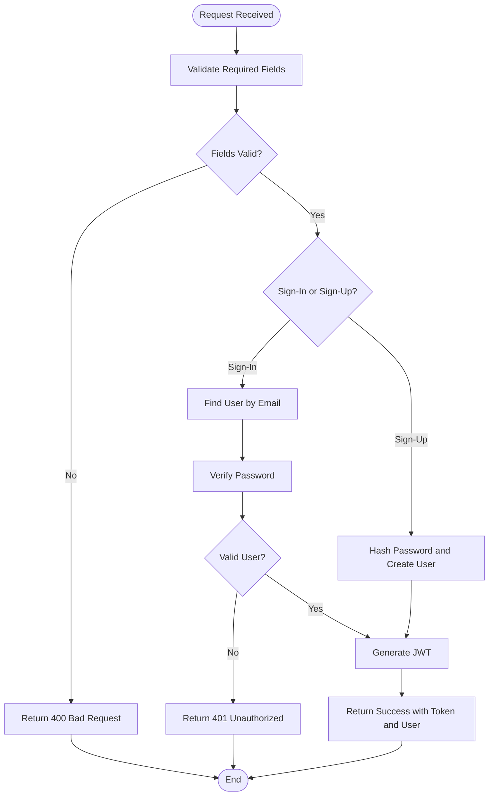
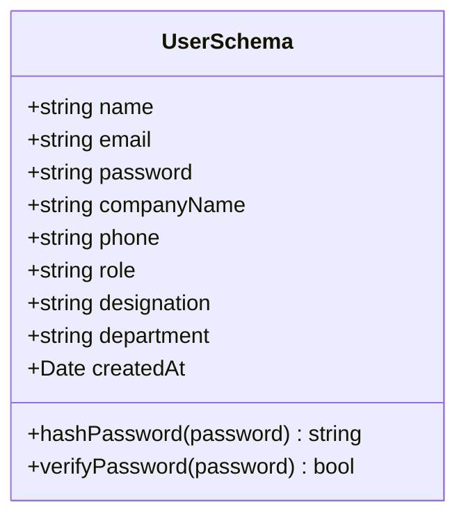
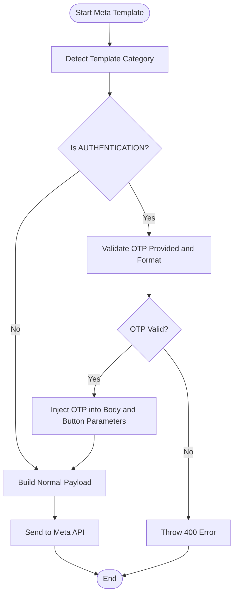
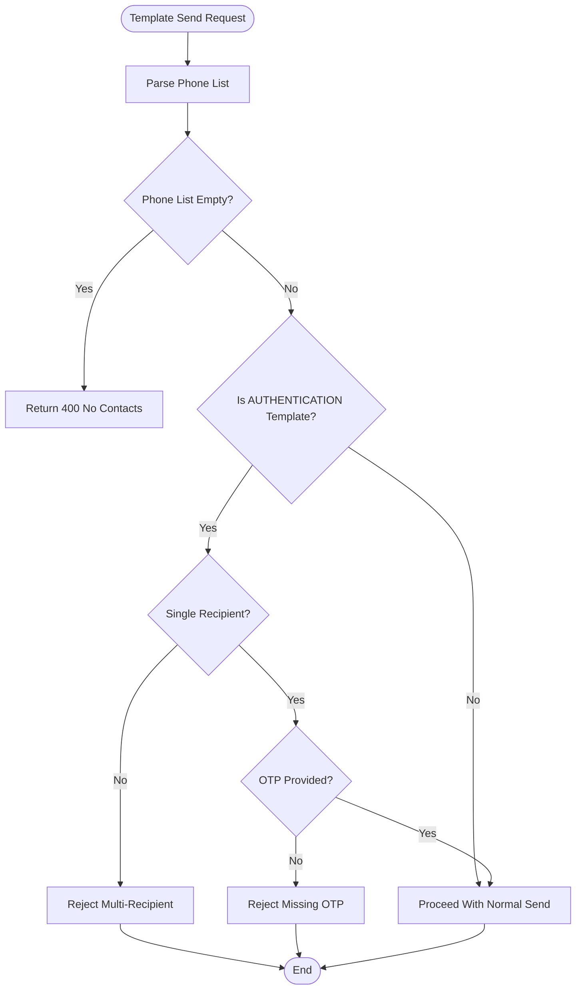
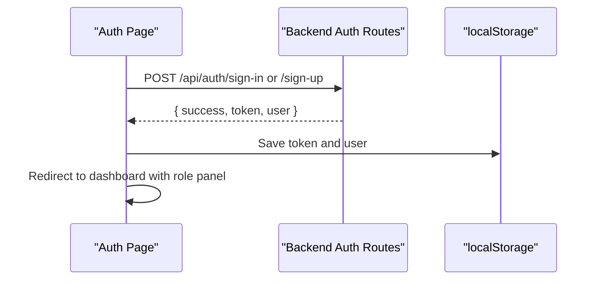
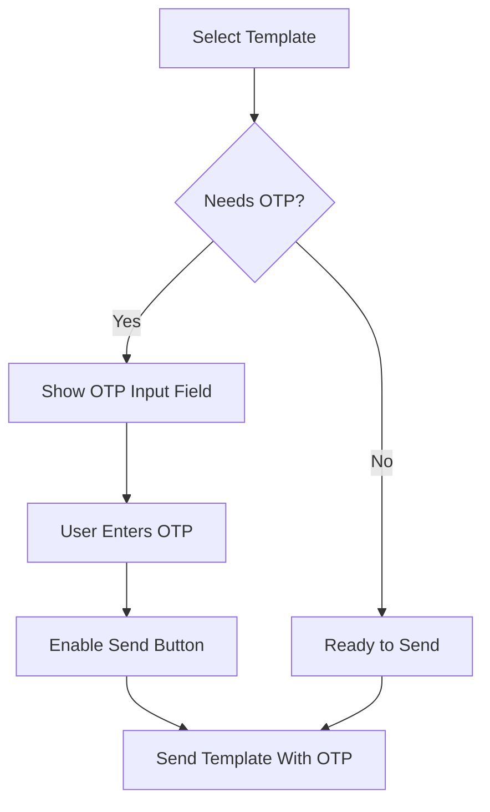
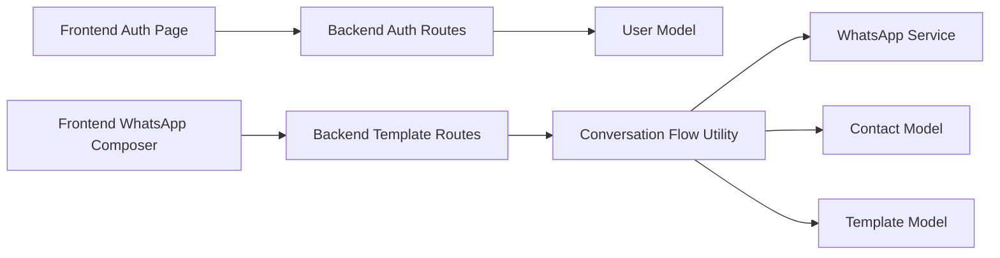

# OTP Authentication Support

<cite>
**Referenced Files in This Document**
- [auth.js](file://backend/routes/auth.js)
- [User.js](file://backend/models/User.js)
- [conversationFlow.js](file://backend/utils/conversationFlow.js)
- [template.js](file://backend/routes/template.js)
- [index.jsx](file://frontend/src/Auth/index.jsx)
- [Whatsapp_Message.jsx](file://frontend/src/Dashboard/Whatsapp_Message.jsx)
</cite>

## Table of Contents
1. [Introduction](#introduction)
2. [Project Structure](#project-structure)
3. [Core Components](#core-components)
4. [Architecture Overview](#architecture-overview)
5. [Detailed Component Analysis](#detailed-component-analysis)
6. [Dependency Analysis](#dependency-analysis)
7. [Performance Considerations](#performance-considerations)
8. [Troubleshooting Guide](#troubleshooting-guide)
9. [Conclusion](#conclusion)

## Introduction
This document explains how OTP authentication support is implemented across the backend and frontend of the project. It covers:
- Email/password-based user authentication with JWT tokens.
- WhatsApp template sending for AUTHENTICATION category templates, including one-time code handling.
- Frontend flows for sign-in/sign-up and OTP input when sending authentication templates.

The goal is to help developers understand where OTP-related logic lives, how it is validated, and how it integrates with Meta’s WhatsApp API through the application.

## Project Structure
OTP authentication spans both backend routes and utilities and the frontend authentication and messaging UI:
- Backend authentication endpoints are defined under `backend/routes/auth.js`.
- User model and password hashing live in `backend/models/User.js`.
- WhatsApp template sending and OTP validation for AUTHENTICATION templates are handled in `backend/utils/conversationFlow.js` and `backend/routes/template.js`.
- Frontend authentication UI is in `frontend/src/Auth/index.jsx`.
- Frontend chat composer OTP input for authentication templates is in `frontend/src/Dashboard/Whatsapp_Message.jsx`.

**Diagram sources**
- [auth.js:1-142](file://backend/routes/auth.js#L1-L142)
- [User.js:1-64](file://backend/models/User.js#L1-L64)
- [conversationFlow.js:1-164](file://backend/utils/conversationFlow.js#L1-L164)
- [template.js:415-448](file://backend/routes/template.js#L415-L448)
- [index.jsx:71-150](file://frontend/src/Auth/index.jsx#L71-L150)
- [Whatsapp_Message.jsx:2118-2158](file://frontend/src/Dashboard/Whatsapp_Message.jsx#L2118-L2158)

**Section sources**
- [auth.js:1-142](file://backend/routes/auth.js#L1-L142)
- [User.js:1-64](file://backend/models/User.js#L1-L64)
- [conversationFlow.js:1-164](file://backend/utils/conversationFlow.js#L1-L164)
- [template.js:415-448](file://backend/routes/template.js#L415-L448)
- [index.jsx:71-150](file://frontend/src/Auth/index.jsx#L71-L150)
- [Whatsapp_Message.jsx:2118-2158](file://frontend/src/Dashboard/Whatsapp_Message.jsx#L2118-L2158)

## Core Components
- Authentication routes provide sign-up, sign-in, and current-user lookup using JWT.
- The User model stores hashed passwords and exposes helper methods for hashing and verification.
- Conversation flow utility validates and builds WhatsApp template payloads, including OTP for AUTHENTICATION templates.
- Template route enforces that AUTHENTICATION templates are sent to a single recipient and require an OTP code.
- Frontend auth page handles sign-in/sign-up and token storage.
- Frontend WhatsApp message composer shows an OTP field when an authentication template is selected.

**Section sources**
- [auth.js:17-133](file://backend/routes/auth.js#L17-L133)
- [User.js:52-61](file://backend/models/User.js#L52-L61)
- [conversationFlow.js:21-47](file://backend/utils/conversationFlow.js#L21-L47)
- [template.js:439-448](file://backend/routes/template.js#L439-L448)
- [index.jsx:71-150](file://frontend/src/Auth/index.jsx#L71-L150)
- [Whatsapp_Message.jsx:2118-2158](file://frontend/src/Dashboard/Whatsapp_Message.jsx#L2118-L2158)

## Architecture Overview
The OTP authentication support has two main parts:
1. Application-level authentication (email/password + JWT).
2. WhatsApp AUTHENTICATION template sending with per-recipient OTP codes.

**Diagram sources**
- [auth.js:17-133](file://backend/routes/auth.js#L17-L133)
- [User.js:52-61](file://backend/models/User.js#L52-L61)
- [index.jsx:71-150](file://frontend/src/Auth/index.jsx#L71-L150)

## Detailed Component Analysis

### Backend Authentication Routes
Responsibilities:
- Handle sign-up and sign-in requests.
- Validate required fields.
- Hash and verify passwords via the User model.
- Issue JWT tokens for authenticated sessions.
- Provide a `/me` endpoint to validate tokens and return user data.

Key behaviors:
- Sign-up creates a new user with normalized email and role defaults.
- Sign-in supports a hardcoded fallback admin account for initial setup.
- `/me` verifies the Authorization header and returns user details without the password.

**Diagram sources**
- [auth.js:17-133](file://backend/routes/auth.js#L17-L133)

**Section sources**
- [auth.js:17-133](file://backend/routes/auth.js#L17-L133)

### User Model and Password Handling
Responsibilities:
- Define user schema with fields like name, email, password, company, phone, role, designation, department, and timestamps.
- Provide static method to hash passwords using PBKDF2.
- Provide instance method to verify passwords against stored hashes.

Important notes:
- Password hashing uses a salt derived from environment configuration or a default value.
- Verification recomputes the hash and compares it to the stored value.

**Diagram sources**
- [User.js:4-61](file://backend/models/User.js#L4-L61)

**Section sources**
- [User.js:4-61](file://backend/models/User.js#L4-L61)

### WhatsApp AUTHENTICATION Template Sending
Responsibilities:
- Detect whether a template belongs to the AUTHENTICATION category.
- Require a one-time code for AUTHENTICATION templates.
- Validate the OTP format and length.
- Inject the OTP into both the body parameter and the copy-code button parameter.
- Send the constructed template payload to Meta.

Validation rules:
- OTP must be provided for AUTHENTICATION templates.
- OTP must be between 4 and 10 characters with no spaces.
- AUTHENTICATION templates should not be sent to multiple recipients because each recipient needs a unique OTP.

**Diagram sources**
- [conversationFlow.js:21-47](file://backend/utils/conversationFlow.js#L21-L47)
- [conversationFlow.js:121-140](file://backend/utils/conversationFlow.js#L121-L140)

**Section sources**
- [conversationFlow.js:21-47](file://backend/utils/conversationFlow.js#L21-L47)
- [conversationFlow.js:121-140](file://backend/utils/conversationFlow.js#L121-L140)

### Template Route OTP Enforcement
Responsibilities:
- Parse phone list from request parameters.
- Determine if the template is AUTHENTICATION.
- Enforce single-recipient sending for AUTHENTICATION templates.
- Ensure OTP code is present for AUTHENTICATION templates.

Behavior:
- If the template is AUTHENTICATION and more than one phone number is provided, the request is rejected.
- The OTP code is read from the request and used only for authentication templates.

**Diagram sources**
- [template.js:425-448](file://backend/routes/template.js#L425-L448)

**Section sources**
- [template.js:425-448](file://backend/routes/template.js#L425-L448)

### Frontend Authentication Page
Responsibilities:
- Render sign-in and sign-up forms.
- Call backend auth endpoints.
- Store JWT token and user info in localStorage.
- Navigate to dashboard based on user role.

Key behaviors:
- Dynamic API base URL selection for local development vs deployed environment.
- Robust response parsing to handle empty or non-JSON responses.
- Role-based redirection after successful authentication.

**Diagram sources**
- [index.jsx:71-150](file://frontend/src/Auth/index.jsx#L71-L150)
- [auth.js:17-133](file://backend/routes/auth.js#L17-L133)

**Section sources**
- [index.jsx:71-150](file://frontend/src/Auth/index.jsx#L71-L150)

### Frontend WhatsApp Message Composer OTP Input
Responsibilities:
- Show an OTP input field when an authentication template is selected.
- Prevent sending unless OTP is provided for authentication templates.
- Pass the OTP to the backend when sending the template.

Key behaviors:
- The OTP field is labeled clearly and includes a hint about its purpose.
- The send button is disabled while waiting for network or when OTP is missing.

**Diagram sources**
- [Whatsapp_Message.jsx:2118-2158](file://frontend/src/Dashboard/Whatsapp_Message.jsx#L2118-L2158)

**Section sources**
- [Whatsapp_Message.jsx:2118-2158](file://frontend/src/Dashboard/Whatsapp_Message.jsx#L2118-L2158)

## Dependency Analysis
The OTP authentication support depends on several modules:
- Auth routes depend on the User model for persistence and password operations.
- Conversation flow utility depends on Contact and Template models and calls the WhatsApp service to send messages.
- Template route depends on Contact and Template models and orchestrates sending logic.
- Frontend auth page depends on backend auth routes and stores tokens locally.
- Frontend WhatsApp message composer depends on template metadata to determine OTP requirements.

**Diagram sources**
- [auth.js:1-142](file://backend/routes/auth.js#L1-L142)
- [User.js:1-64](file://backend/models/User.js#L1-L64)
- [conversationFlow.js:1-164](file://backend/utils/conversationFlow.js#L1-L164)
- [template.js:415-448](file://backend/routes/template.js#L415-L448)
- [index.jsx:71-150](file://frontend/src/Auth/index.jsx#L71-L150)
- [Whatsapp_Message.jsx:2118-2158](file://frontend/src/Dashboard/Whatsapp_Message.jsx#L2118-L2158)

**Section sources**
- [auth.js:1-142](file://backend/routes/auth.js#L1-L142)
- [User.js:1-64](file://backend/models/User.js#L1-L64)
- [conversationFlow.js:1-164](file://backend/utils/conversationFlow.js#L1-L164)
- [template.js:415-448](file://backend/routes/template.js#L415-L448)
- [index.jsx:71-150](file://frontend/src/Auth/index.jsx#L71-L150)
- [Whatsapp_Message.jsx:2118-2158](file://frontend/src/Dashboard/Whatsapp_Message.jsx#L2118-L2158)

## Performance Considerations
- Password hashing uses PBKDF2 with a fixed iteration count; ensure environment variables are configured securely to avoid weak salts.
- JWT expiration is set to seven days; consider rotating secrets and shortening token lifetimes for higher security environments.
- OTP validation is lightweight regex-based; keep OTP length constraints reasonable to balance usability and security.
- Avoid sending AUTHENTICATION templates to multiple recipients to prevent OTP reuse and reduce risk.

[No sources needed since this section provides general guidance]

## Troubleshooting Guide
Common issues and resolutions:
- Empty or non-JSON auth responses: The frontend parser detects empty bodies and HTML responses and surfaces clear error messages.
- Invalid or expired JWT: The `/me` endpoint returns unauthorized errors when tokens are invalid or expired.
- Missing OTP for authentication templates: The conversation flow utility throws a validation error if OTP is not provided or does not match the expected format.
- Attempting to send authentication templates to multiple recipients: The template route rejects such requests to prevent OTP leakage.

Recommended checks:
- Verify environment variables for API base URLs and JWT secret.
- Confirm that the WhatsApp Messaging Account is enabled for Direct Send if using direct authentication/utility sends.
- Ensure contact opt-out status is respected before sending.

**Section sources**
- [index.jsx:34-57](file://frontend/src/Auth/index.jsx#L34-L57)
- [auth.js:115-133](file://backend/routes/auth.js#L115-L133)
- [conversationFlow.js:34-47](file://backend/utils/conversationFlow.js#L34-L47)
- [template.js:439-448](file://backend/routes/template.js#L439-L448)

## Conclusion
OTP authentication support in this project combines secure user login with WhatsApp AUTHENTICATION template sending. The backend validates OTPs and constructs appropriate Meta template payloads, while the frontend guides users through sign-in/sign-up and OTP entry for authentication templates. Following the validation rules and single-recipient constraint ensures safe and correct OTP delivery.

[No sources needed since this section summarizes without analyzing specific files]