# Template Management

<cite>
**Referenced Files in This Document**   
- [Template.js](file://backend/models/Template.js)
- [template.js](file://backend/routes/template.js)
- [metaTemplateService.js](file://backend/utils/metaTemplateService.js)
- [conversationFlow.js](file://backend/utils/conversationFlow.js)
- [templateBuilder.js](file://backend/utils/templateBuilder.js)
- [Whatsapp_Message.jsx](file://frontend/src/Dashboard/Whatsapp_Message.jsx)
- [WhatsappBlast.jsx](file://frontend/src/Dashboard/WhatsappBlast.jsx)
</cite>

## Update Summary
**Changes Made**
- Added comprehensive documentation for the new templateBuilder.js utility
- Updated template creation and editing workflows to reflect centralized validation and normalization
- Enhanced category preset system documentation with backend-driven presets
- Updated template recreation workflow documentation
- Added detailed validation rules and error handling documentation
- Enhanced preview and testing capabilities documentation

## Table of Contents
1. [Introduction](#introduction)
2. [Project Structure](#project-structure)
3. [Core Components](#core-components)
4. [Architecture Overview](#architecture-overview)
5. [Detailed Component Analysis](#detailed-component-analysis)
6. [Dependency Analysis](#dependency-analysis)
7. [Performance Considerations](#performance-considerations)
8. [Troubleshooting Guide](#troubleshooting-guide)
9. [Conclusion](#conclusion)

## Introduction
This document explains the template management system for WhatsApp messaging, covering:
- Template creation, editing, and synchronization with Meta's template system
- Centralized template normalization, validation, and category presets via templateBuilder.js
- Approval workflows and status tracking
- Parameterized messages and dynamic content insertion
- Preview and testing capabilities
- Bulk operations and campaign execution
- Versioning considerations and rollback strategies
- Performance optimization recommendations

The system supports text templates, media attachments (images, videos, documents), and interactive buttons. Templates are stored locally and synchronized with Meta, where approval is required before sending. The new templateBuilder.js utility provides comprehensive template normalization, validation, category presets, and recreation workflows.

## Project Structure
The template feature spans backend models, routes, utilities, and frontend dashboards:
- Backend model defines template schema and fields
- Routes expose endpoints for CRUD, sync, send, schedule, and stats
- **New**: templateBuilder.js provides centralized template normalization, validation, and category presets
- Utilities handle Meta API interactions and message composition
- Frontend provides editor, preview, bulk blast, and live chat integration

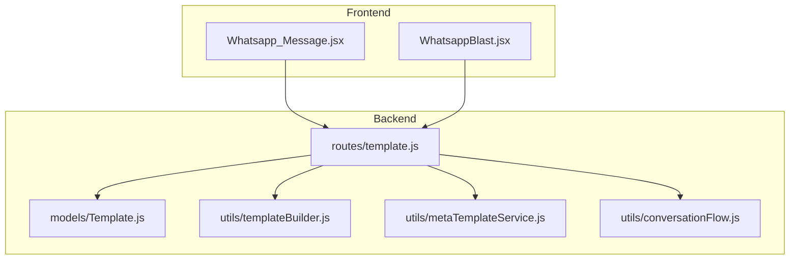

**Diagram sources**
- [template.js:1-30](file://backend/routes/template.js#L1-L30)
- [Template.js:1-74](file://backend/models/Template.js#L1-L74)
- [templateBuilder.js:1-614](file://backend/utils/templateBuilder.js#L1-L614)
- [metaTemplateService.js:1-255](file://backend/utils/metaTemplateService.js#L1-L255)
- [conversationFlow.js:1-118](file://backend/utils/conversationFlow.js#L1-L118)
- [Whatsapp_Message.jsx:1-200](file://frontend/src/Dashboard/Whatsapp_Message.jsx#L1-L200)
- [WhatsappBlast.jsx:67-113](file://frontend/src/Dashboard/WhatsappBlast.jsx#L67-L113)

**Section sources**
- [Template.js:1-74](file://backend/models/Template.js#L1-L74)
- [template.js:1-30](file://backend/routes/template.js#L1-L30)
- [templateBuilder.js:1-614](file://backend/utils/templateBuilder.js#L1-L614)
- [metaTemplateService.js:1-255](file://backend/utils/metaTemplateService.js#L1-L255)
- [conversationFlow.js:1-118](file://backend/utils/conversationFlow.js#L1-L118)
- [Whatsapp_Message.jsx:1-200](file://frontend/src/Dashboard/Whatsapp_Message.jsx#L1-L200)
- [WhatsappBlast.jsx:67-113](file://frontend/src/Dashboard/WhatsappBlast.jsx#L67-L113)

## Core Components
- **Template Model**: Stores both legacy fields and Meta-specific fields, including components, metaTemplateId, metaStatus, and WABA association.
- **Template Routes**: Provide endpoints to create/update/import/sync templates, check status, send templates, schedule broadcasts, and fetch stats.
- **Template Builder Utility**: **NEW** - Centralized template normalization, validation, category presets, and recreation workflows.
- **Meta Template Service**: Handles Meta API calls for creating templates, fetching all templates, checking status, and uploading media.
- **Conversation Flow**: Composes parameters for header media and body variables, then sends via Meta Cloud API.
- **Frontend Editor and Blast UI**: Provides template creation/editing, preview, parameter substitution, sync, and bulk dispatch.

Key responsibilities:
- Create or update templates locally and on Meta using centralized validation
- Synchronize templates from Meta into local storage
- Validate and sanitize components (variables, buttons, headers) through templateBuilder.js
- Send approved templates to contacts with dynamic content
- Schedule and run broadcasts
- **NEW**: Provide category presets and validation rules to frontend

**Section sources**
- [Template.js:1-74](file://backend/models/Template.js#L1-L74)
- [template.js:283-365](file://backend/routes/template.js#L283-L365)
- [templateBuilder.js:1-614](file://backend/utils/templateBuilder.js#L1-L614)
- [metaTemplateService.js:114-154](file://backend/utils/metaTemplateService.js#L114-L154)
- [conversationFlow.js:21-118](file://backend/utils/conversationFlow.js#L21-L118)
- [Whatsapp_Message.jsx:763-845](file://frontend/src/Dashboard/Whatsapp_Message.jsx#L763-L845)
- [WhatsappBlast.jsx:276-327](file://frontend/src/Dashboard/WhatsappBlast.jsx#L276-L327)

## Architecture Overview
The template lifecycle involves:
- **Creation**: Frontend builds components; backend uses templateBuilder.js for normalization and validation; submits to Meta; stores local copy with metaTemplateId and metaStatus.
- **Sync**: Fetch all templates from Meta; deduplicate; auto-host images to Cloudinary; persist locally.
- **Approval Workflow**: Check status against Meta; enforce APPROVED state before sending.
- **Sending**: Compose parameters (header media, body variables); send via Meta Cloud API; log results.
- **Preview/Test**: Render preview with sample values; test single send; bulk blast to selected recipients.

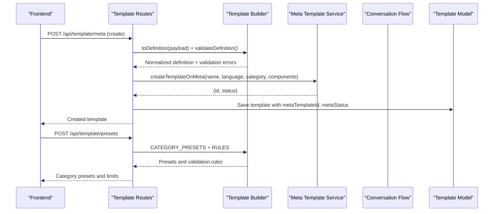

**Diagram sources**
- [template.js:806-845](file://backend/routes/template.js#L806-L845)
- [template.js:786-788](file://backend/routes/template.js#L786-L788)
- [templateBuilder.js:183-245](file://backend/utils/templateBuilder.js#L183-L245)
- [templateBuilder.js:310-419](file://backend/utils/templateBuilder.js#L310-L419)
- [templateBuilder.js:543-581](file://backend/utils/templateBuilder.js#L543-L581)

## Detailed Component Analysis

### Template Model and Data Structure
The Template model includes:
- Meta-specific fields: name, category, language, components, metaTemplateId, metaStatus, wabaId
- Legacy fields: title, message, footer, imageUrl, mediaId
- Stats and scheduling: contacts, totalSent, totalFailed, interested, notInterested, ordersGenerated, status, sentAt, isScheduled, scheduleTime, repeatDaily, scheduleDays, lastRunAt, nextRunAt, isActive

Complexity:
- O(1) access to fields; array-based components allow flexible structure.
- Deduplication during sync uses $or queries by metaTemplateId or name.

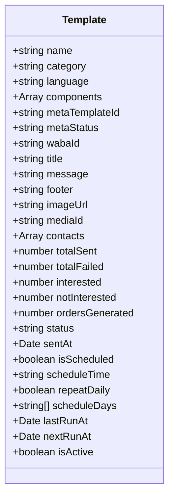

**Diagram sources**
- [Template.js:3-72](file://backend/models/Template.js#L3-L72)

**Section sources**
- [Template.js:1-74](file://backend/models/Template.js#L1-L74)

### Template Creation and Editing with Template Builder
**Updated** - Now uses centralized templateBuilder.js for normalization and validation

- Create endpoint: POST /api/template/meta
  - Accepts name, language, category, components, optional media file
  - Uses templateBuilder.js to normalize and validate input
  - Uploads media to Meta; updates HEADER component example.handle
  - Saves local template with metaTemplateId and metaStatus
- Update endpoint: PUT /api/template/:id
  - Supports updating name, category, language, components, image URL
  - Handles JSON string parsing for components
  - Uses templateBuilder.js for validation and normalization

Validation and sanitization through templateBuilder.js:
- Body variables normalized to {{1}}, {{2}}...
- Buttons sanitized to max 3 entries; phone numbers and URLs normalized
- Category presets provided for MARKETING, UTILITY, AUTHENTICATION
- Comprehensive validation rules enforced

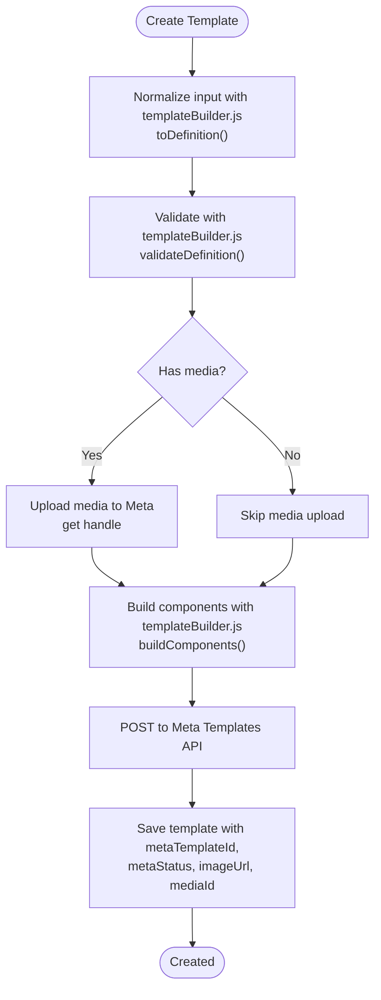

**Diagram sources**
- [template.js:146-170](file://backend/routes/template.js#L146-L170)
- [templateBuilder.js:183-245](file://backend/utils/templateBuilder.js#L183-L245)
- [templateBuilder.js:252-299](file://backend/utils/templateBuilder.js#L252-L299)

**Section sources**
- [template.js:806-845](file://backend/routes/template.js#L806-L845)
- [template.js:599-748](file://backend/routes/template.js#L599-L748)
- [templateBuilder.js:183-245](file://backend/utils/templateBuilder.js#L183-L245)
- [templateBuilder.js:252-299](file://backend/utils/templateBuilder.js#L252-L299)
- [templateBuilder.js:310-419](file://backend/utils/templateBuilder.js#L310-L419)

### Category Presets and Validation Rules
**NEW** - Comprehensive category system with backend-driven presets

The templateBuilder.js provides:
- **Category Presets**: Predefined templates for MARKETING, UTILITY, and AUTHENTICATION categories
- **Validation Rules**: Enforced limits for text lengths, button counts, and field constraints
- **Normalization Functions**: Standardize names, categories, languages, and button types
- **Error Handling**: Rich error messages with hints for common Meta API issues

Category presets include:
- **MARKETING**: Promotional templates with image headers, promotional body text, and call-to-action buttons
- **UTILITY**: Transactional templates with text headers, order-related body text, and support buttons  
- **AUTHENTICATION**: OTP templates with no header, automatic body generation, and copy-code buttons

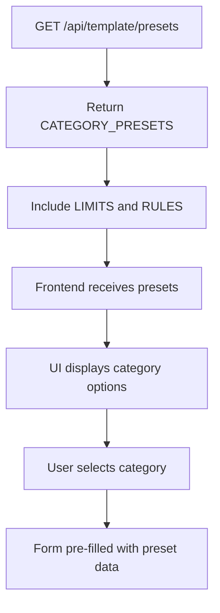

**Diagram sources**
- [template.js:786-788](file://backend/routes/template.js#L786-L788)
- [templateBuilder.js:543-581](file://backend/utils/templateBuilder.js#L543-L581)
- [templateBuilder.js:583-593](file://backend/utils/templateBuilder.js#L583-L593)

**Section sources**
- [templateBuilder.js:543-581](file://backend/utils/templateBuilder.js#L543-L581)
- [templateBuilder.js:583-593](file://backend/utils/templateBuilder.js#L583-L593)
- [template.js:786-788](file://backend/routes/template.js#L786-L788)

### Template Recreation Workflow
**NEW** - Robust template recreation system for Meta-immutability

Since Meta doesn't allow editing submitted templates, the system implements a recreation workflow:
- Detect when content changes require recreation vs. simple updates
- Delete existing Meta template if successful
- Submit new version with updated content
- Handle failures gracefully by keeping local drafts
- Support both explicit recreation requests and automatic detection

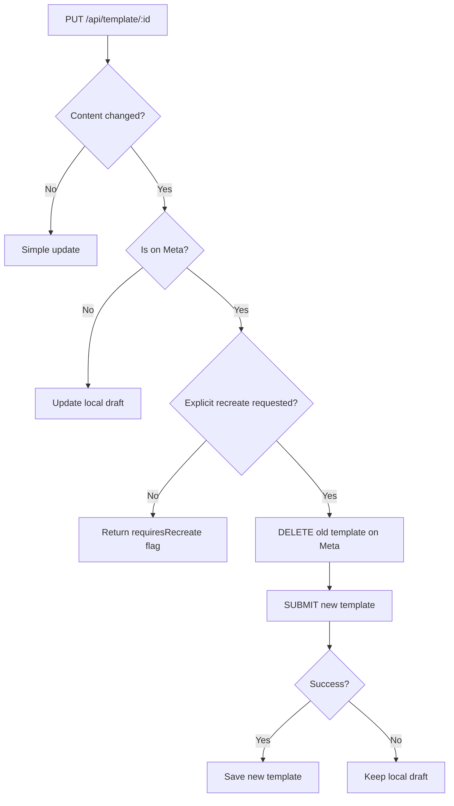

**Diagram sources**
- [template.js:255-287](file://backend/routes/template.js#L255-L287)
- [template.js:599-748](file://backend/routes/template.js#L599-L748)

**Section sources**
- [template.js:255-287](file://backend/routes/template.js#L255-L287)
- [template.js:599-748](file://backend/routes/template.js#L599-L748)
- [template.js:752-782](file://backend/routes/template.js#L752-L782)

### Synchronization with Meta
- Sync endpoint: POST /api/template/sync-meta or /api/template/sync
  - Fetches all templates from Meta
  - Deduplicates by metaTemplateId or name
  - Updates existing records or creates new ones
  - Auto-hosts header images to Cloudinary if needed
  - Cleans up outdated templates not present in Meta

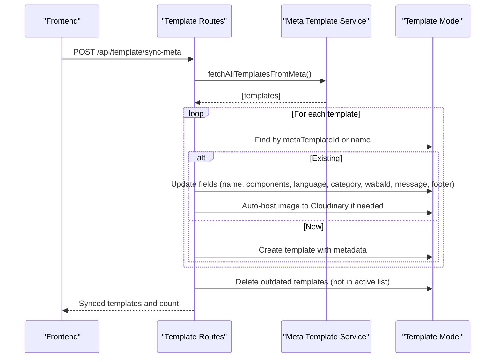

**Diagram sources**
- [template.js:896-1015](file://backend/routes/template.js#L896-L1015)
- [metaTemplateService.js:163-179](file://backend/utils/metaTemplateService.js#L163-L179)

**Section sources**
- [template.js:896-1015](file://backend/routes/template.js#L896-L1015)

### Approval Workflows and Status Tracking
- Status check: GET /api/template/meta/:id/status
  - Retrieves current status from Meta
  - Updates local metaStatus accordingly
- Before sending:
  - Endpoint verifies APPROVED status on Meta
  - Rejects sending if not approved

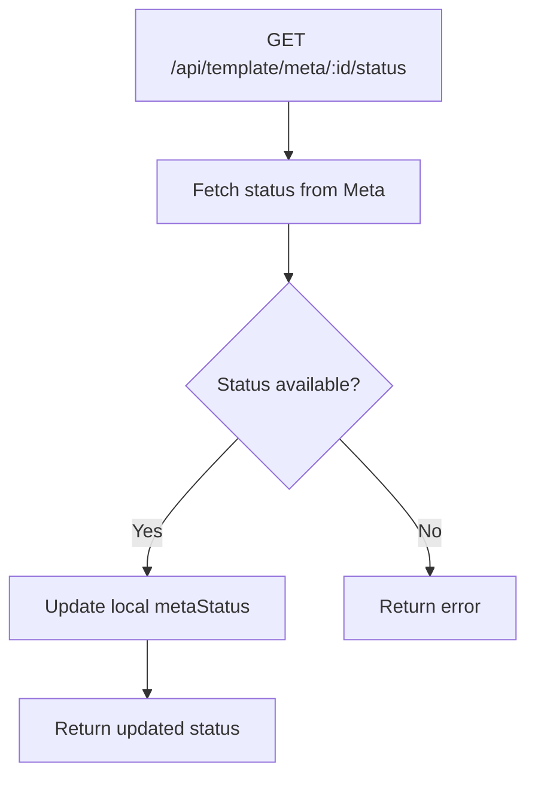

**Diagram sources**
- [template.js:1022-1047](file://backend/routes/template.js#L1022-L1047)

**Section sources**
- [template.js:1022-1047](file://backend/routes/template.js#L1022-L1047)

### Template Testing and Preview
- Preview rendering:
  - Frontend replaces {{1}}, {{2}} with sample values
  - Displays header (image/text), body, footer, and buttons
- Single test send:
  - Frontend triggers a test message using selected template and a test phone number
- Live chat integration:
  - Select approved template and send to a contact directly

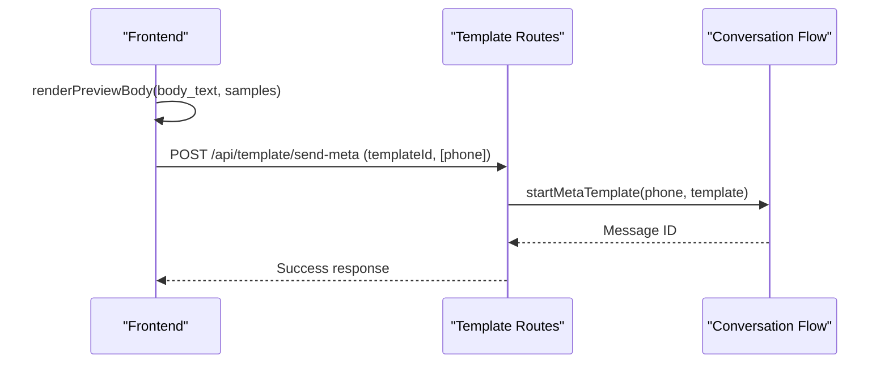

**Diagram sources**
- [Whatsapp_Message.jsx:37-63](file://frontend/src/Dashboard/Whatsapp_Message.jsx#L37-L63)
- [Whatsapp_Message.jsx:667-733](file://frontend/src/Dashboard/Whatsapp_Message.jsx#L667-L733)
- [template.js:397-469](file://backend/routes/template.js#L397-L469)
- [conversationFlow.js:21-118](file://backend/utils/conversationFlow.js#L21-L118)

**Section sources**
- [Whatsapp_Message.jsx:37-63](file://frontend/src/Dashboard/Whatsapp_Message.jsx#L37-L63)
- [Whatsapp_Message.jsx:667-733](file://frontend/src/Dashboard/Whatsapp_Message.jsx#L667-L733)

### Bulk Operations and Campaign Execution
- Bulk blast:
  - Select template and recipients (contacts or leads)
  - Dispatch batch via /api/leads/whatsapp-blast
- Scheduled broadcasts:
  - Schedule templates with time, repeat options
  - Run scheduled templates periodically

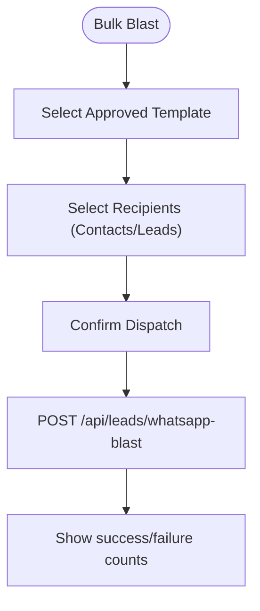

**Diagram sources**
- [WhatsappBlast.jsx:276-327](file://frontend/src/Dashboard/WhatsappBlast.jsx#L276-L327)

**Section sources**
- [WhatsappBlast.jsx:276-327](file://frontend/src/Dashboard/WhatsappBlast.jsx#L276-L327)

### Relationship Between Templates and Campaign Execution
- Template selection logic:
  - Frontend maps backend template data to UI fields (header_type, header_text/image_url, body_text, footer_text, buttons)
  - Only APPROVED templates are selectable for sending
- Dynamic content insertion:
  - Body variables replaced with recipient-specific values (e.g., name)
  - Header media resolved via mediaId or public link

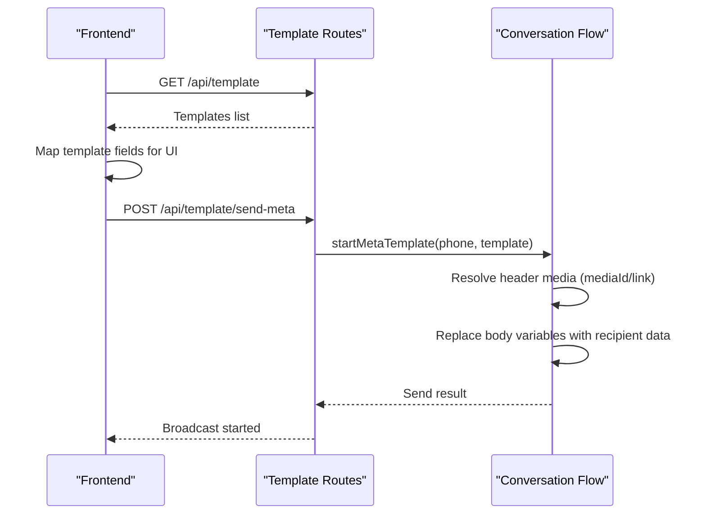

**Diagram sources**
- [Whatsapp_Message.jsx:254-299](file://frontend/src/Dashboard/Whatsapp_Message.jsx#L254-L299)
- [WhatsappBlast.jsx:81-113](file://frontend/src/Dashboard/WhatsappBlast.jsx#L81-L113)
- [conversationFlow.js:21-118](file://backend/utils/conversationFlow.js#L21-L118)

**Section sources**
- [Whatsapp_Message.jsx:254-299](file://frontend/src/Dashboard/Whatsapp_Message.jsx#L254-L299)
- [WhatsappBlast.jsx:81-113](file://frontend/src/Dashboard/WhatsappBlast.jsx#L81-L113)
- [conversationFlow.js:21-118](file://backend/utils/conversationFlow.js#L21-L118)

## Dependency Analysis
- Template Routes depend on:
  - Template Model for persistence
  - **NEW**: Template Builder for normalization, validation, and presets
  - Meta Template Service for API interactions
  - Conversation Flow for composing and sending messages
  - Cloudinary service for media hosting
- Frontend depends on:
  - Template Routes for CRUD and sync
  - Contact/Lead APIs for recipient lists

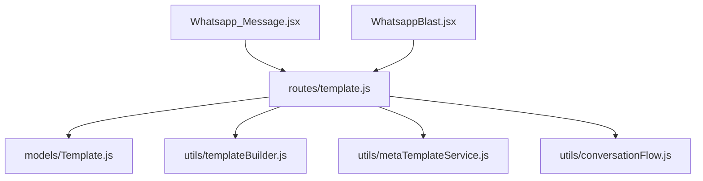

**Diagram sources**
- [template.js:1-30](file://backend/routes/template.js#L1-L30)
- [Template.js:1-74](file://backend/models/Template.js#L1-L74)
- [templateBuilder.js:1-614](file://backend/utils/templateBuilder.js#L1-L614)
- [metaTemplateService.js:1-255](file://backend/utils/metaTemplateService.js#L1-L255)
- [conversationFlow.js:1-118](file://backend/utils/conversationFlow.js#L1-L118)
- [Whatsapp_Message.jsx:376-448](file://frontend/src/Dashboard/Whatsapp_Message.jsx#L376-L448)
- [WhatsappBlast.jsx:67-113](file://frontend/src/Dashboard/WhatsappBlast.jsx#L67-L113)

**Section sources**
- [template.js:1-30](file://backend/routes/template.js#L1-L30)
- [Template.js:1-74](file://backend/models/Template.js#L1-L74)
- [templateBuilder.js:1-614](file://backend/utils/templateBuilder.js#L1-L614)
- [metaTemplateService.js:1-255](file://backend/utils/metaTemplateService.js#L1-L255)
- [conversationFlow.js:1-118](file://backend/utils/conversationFlow.js#L1-L118)
- [Whatsapp_Message.jsx:376-448](file://frontend/src/Dashboard/Whatsapp_Message.jsx#L376-L448)
- [WhatsappBlast.jsx:67-113](file://frontend/src/Dashboard/WhatsappBlast.jsx#L67-L113)

## Performance Considerations
- Media handling:
  - Prefer Cloudinary-hosted images to reduce latency
  - Avoid repeated uploads; cache mediaId when possible
- Rate limiting:
  - Use delays between sends to respect Meta API limits
- Database queries:
  - Filter templates by wabaId to reduce dataset size
  - Index frequently queried fields (metaTemplateId, name)
- Preview rendering:
  - Minimize re-renders by memoizing computed previews
- **NEW**: Template builder performance:
  - Centralized validation reduces redundant processing
  - Category presets minimize frontend computation
  - Normalization functions optimized for common patterns

[No sources needed since this section provides general guidance]

## Troubleshooting Guide
Common issues and resolutions:
- Missing Meta credentials:
  - Ensure WABA ID and token are configured
- Invalid template name or components:
  - Use templateBuilder.js slugifyName() for proper formatting
  - Ensure BODY variables are properly formatted with matching samples
- Media upload failures:
  - Verify file type and size constraints
  - Check Cloudinary configuration
- Sending errors:
  - Confirm template status is APPROVED on Meta
  - Validate phone number format
- **NEW**: Template validation errors:
  - Check templateBuilder.js validation rules for specific field constraints
  - Review category-specific requirements (e.g., AUTHENTICATION templates cannot have headers)
  - Use /api/template/presets to get current validation rules and limits

**Section sources**
- [metaTemplateService.js:6-21](file://backend/utils/metaTemplateService.js#L6-L21)
- [template.js:806-845](file://backend/routes/template.js#L806-L845)
- [template.js:397-469](file://backend/routes/template.js#L397-L469)
- [templateBuilder.js:310-419](file://backend/utils/templateBuilder.js#L310-L419)

## Conclusion
The template management system provides a robust framework for creating, editing, and deploying WhatsApp templates with Meta integration. The new templateBuilder.js utility centralizes template normalization, validation, and category presets, providing a consistent foundation for template operations. It supports parameterized messages, media attachments, approval workflows, and bulk operations. While versioning and rollback are not explicitly implemented, the system can be extended to track historical versions and support rollbacks by leveraging the existing template model and sync mechanisms. The centralized approach ensures consistency across the application and provides better error handling and user experience.

[No sources needed since this section summarizes without analyzing specific files]